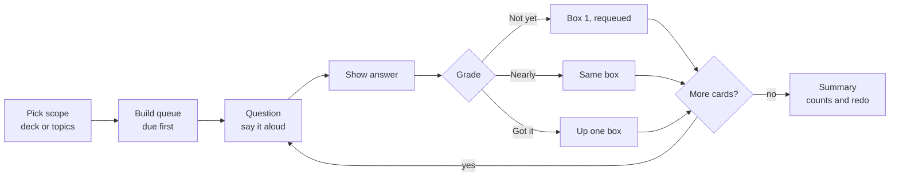
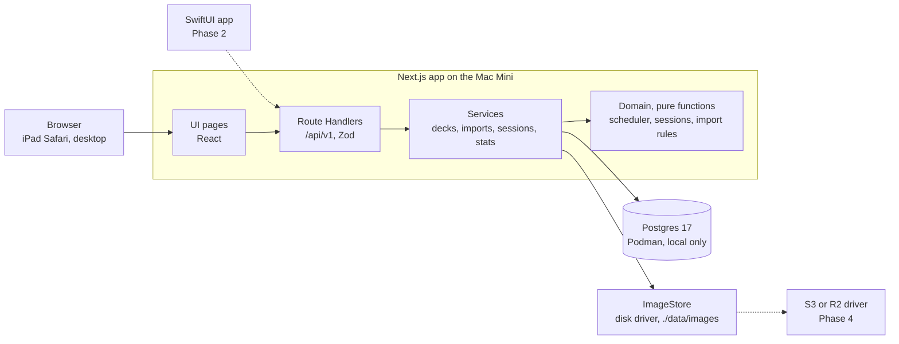
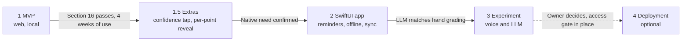

# Flipside: Product Requirements Document

| | |
| --- | --- |
| Status | Draft 1, ready for MVP build planning |
| Last updated | 2026-11-03 (v0.3 review: requirements U, AG, P6-P7, R15-R18, T6-T8, D8, I7; AC14-AC21) |
| Owner | Davi |
| Source | Written from the planning conversation; the decision log is section 18 |

Diagrams are Mermaid and render on GitHub. Mockups are linked in section 18.

## Contents

1. [Overview](#1-overview)
2. [Users and profiles](#2-users-and-profiles)
3. [Scope and phases](#3-scope-and-phases)
4. [Functional requirements](#4-functional-requirements)
5. [Learning model](#5-learning-model)
6. [Import format](#6-import-format)
7. [Statistics](#7-statistics)
8. [UX and accessibility](#8-ux-and-accessibility)
9. [Architecture and tech stack](#9-architecture-and-tech-stack)
10. [Data model](#10-data-model)
11. [API](#11-api)
12. [Image storage](#12-image-storage)
13. [Local environment and operations](#13-local-environment-and-operations)
14. [Native-readiness constraints](#14-native-readiness-constraints)
15. [Roadmap and experiments](#15-roadmap-and-experiments)
16. [Testing and acceptance](#16-testing-and-acceptance)
17. [Risks, assumptions and open questions](#17-risks-assumptions-and-open-questions)
18. [Decision log, glossary and references](#18-decision-log-glossary-and-references)

## 1. Overview

Flipside is a local-first flashcard app for spaced, self-graded revision, built for one secondary-school student who benefits from dyslexia-friendly reading support and one adult preparing for engineering interviews. It replaces paper cards and Anki, keeping Anki's proven method (retrieval practice with spaced repetition) in an interface a young learner actually wants to open.

### Problem

- Paper flashcards work when a parent quizzes, but nothing schedules reviews or records what is weak.
- Anki's scheduling is sound, but its interface is dated and not tuned for learners with dyslexia. The iOS app is paid, and importing CSV on iOS may need the desktop app.
- The same tool must also serve a very different kind of content: long, multi-point answers for System Design and other engineering topics.

### Goals

| ID | Goal |
| --- | --- |
| G1 | Daily practice that schedules itself: each card returns when it is due, not when someone remembers. |
| G2 | A reading experience a dyslexic learner can tune (font, size, spacing, colour) and that feels designed for young learners. |
| G3 | Any subject: school topics and engineering topics live in the same app, one deck per subject, with short or multi-point answers. |
| G4 | Content in minutes without typing: import a CSV (with images) produced from existing material. |
| G5 | Honest progress data: performance, frequency and time per card, with definitions that cannot flatter the learner. |
| G6 | A codebase and API that a native SwiftUI app can reuse later without a rewrite of the backend. |

### Non-goals for the MVP

- Internet deployment, user accounts, passwords or any login beyond choosing a profile.
- Offline use, background sync and push or local notifications (these arrive with the native app).
- A smarter scheduler (FSRS), add-ons, cloze or image-occlusion cards, an in-app card editor, deck sharing between profiles.
- Any LLM or voice feature (roadmap only, section 15).

### Success measures

There is no baseline data yet, so these are initial heuristics to revisit after four weeks of use.

- Both profiles complete a practice session on most days of a week, for four consecutive weeks.
- The learner reports the reading settings as comfortable and keeps using the app without being asked.
- The acceptance criteria in section 16 pass on an iPad over the home network.
- No data loss: a restore from backup reproduces decks, progress and images.

## 2. Users and profiles

The MVP has two profiles, chosen from a Netflix-style picker, with no passwords: whoever holds the iPad picks a face and goes in.

### Profiles

| Profile | Who | Main use | Device |
| --- | --- | --- | --- |
| Student | Secondary-school student who benefits from reading support, preparing for school exams | Short, frequent sessions on school subjects; heavy use of reading settings and read-aloud | iPad (primary) |
| Engineer | Adult software engineer | System Design and other engineering topics for interview prep; longer multi-point answers | iPad, desktop browser |

The model is multi-profile, not two hard-coded users: adding a profile later is an insert, not a code change.

### Profile behaviour

- **Picker:** the first screen when no profile is remembered. Each profile is a large avatar and a name. Avatars come from a built-in set of illustrations; photo upload is out of scope.
- **Remembered choice:** an HTTP cookie (`flipside_profile`) holds the profile id. It is an identifier, not a credential.
- **Switching:** the sidebar shows the current avatar and name with a Switch profile action that returns to the picker. The choice is never locked.
- **Separation:** decks, cards, images, progress, review history, statistics and settings belong to one profile. Nothing is visible across profiles in the MVP.
- **Ownership:** a deck belongs to the profile that created or imported it. Cards, images and progress follow the deck's owner.

### Profile fields

| Field | Default | Notes |
| --- | --- | --- |
| name | n/a | Display name, up to 24 characters |
| avatar | first unused | Id from the built-in set |
| accent colour | design primary | Used in the profile picker and sidebar only |
| timezone | Europe/London | Decides what "today" is for due dates and statistics |
| day start hour | 07:00 | A review at 06:30 still counts toward the previous day |
| settings | see section 4 | Reading and practice settings, stored as JSON |

### Security stance for the MVP

The app runs on the home network only. Since v0.3 a single shared app password (AG1 to AG3) gates every screen and API route, so someone on the network must sign in once per device before picking a profile. Profiles themselves stay password-free behind the gate. This is a household lock, not per-user authentication: it keeps casual visitors on the Wi-Fi out, and nothing more is claimed. The Postgres port is not exposed to the network. If the app is ever deployed beyond the home network, an access gate is a prerequisite (section 15).

## 3. Scope and phases

The MVP is a web app running locally on a Mac Mini, used from an iPad over the home network; everything beyond that is sequenced into later phases that the MVP's design keeps open.

### In scope for the MVP

- Profile picker and per-profile data separation.
- Library of decks grouped by name, with search, today's due count and one-tap start.
- Deck page with topic-level progress and topic selection.
- Practice sessions: flip, three-grade self-assessment, undo, end session, read-aloud, summary.
- A boxed (Leitner) scheduler with failed-card re-queue, a new-cards-per-day cap and leech flagging.
- CSV import, with or without a zip of images, with preview, validation and re-import updates.
- Image support through a storage interface with a disk driver.
- Statistics: performance, frequency and time per card, computed on the server.
- Reading and practice settings per profile, including a light and dark theme toggle.
- Local operations: Podman Postgres, backup and restore scripts, seed data.

### Explicitly out of scope for the MVP

- Deployment to Netlify, Cloudflare or Vercel, and per-user authentication. The single shared app password (AG1 to AG3) is in scope; it is not an access gate for an internet-facing host (section 15).
- Offline mode, service workers, push or local notifications.
- Deck sharing between profiles, in-app card editing, card search by text beyond deck and topic names.
- FSRS or any scheduler other than the boxed one.
- Confidence rating, voice answers, LLM grading and feedback.
- Phone layouts. The design target is iPad landscape, with iPad portrait and desktop browsers as supported secondary sizes.

### Phases

| Phase | Name | Contents | Exit gate |
| --- | --- | --- | --- |
| 1 | MVP | Everything above | Section 16 acceptance criteria pass; both profiles use it for four weeks |
| 1.5 | Evidence-backed extras | Confidence tap before the answer, earlier re-test of high-confidence errors, optional test-date cram mode, per-point reveal | Native need confirmed (reminders look worth building) |
| 2 | SwiftUI app | Native client, study-plan reminders (local notifications), offline use, sync endpoints, real login | LLM grading agrees with hand grading in a recorded test |
| 3 | Experimental | Spoken answers with LLM grading and feedback, run as a randomised test | Owner decides to host, with an access gate ready |
| 4 | Optional deployment | Internet-facing host, access gate, object storage | Hosted behind the access gate |

The roadmap diagram in section 15 shows the same sequence with gates.

## 4. Functional requirements

Each requirement has an id so tests, tickets and the changelog can point at it. Priority: Must = needed for the MVP to be accepted, Should = planned for the MVP but can slip, Could = nice to have.

### Profiles (P)

| ID | Requirement | Priority |
| --- | --- | --- |
| P1 | Show a profile picker with avatar and name when no valid profile cookie exists. | Must |
| P2 | Selecting a profile sets the cookie and opens the Library. | Must |
| P3 | Sidebar shows the current profile and a Switch profile action at any time. | Must |
| P4 | Every query is scoped to the current profile; requests for another profile's data return 404. | Must |
| P5 | Profiles are created by seed script in the MVP; no create-profile UI. | Must |
| P6 | Tapping the current avatar in the top bar opens the Profile page (`/profile`). | Must |
| P7 | The Profile page lets the current profile change its avatar (choosing from the built-in set, P-fields) and its display name (1 to 24 characters, trimmed). The change is saved on the server and shows at once in the top bar, sidebar and profile picker. Two profiles may share an avatar. | Must |

### Library (L)

| ID | Requirement | Priority |
| --- | --- | --- |
| L1 | A Today panel shows total cards due, the number of decks with due cards and the configured session length. | Must |
| L2 | Start practice builds a session from all due cards across all decks of the profile. | Must |
| L3 | Weak cards builds a session from weak cards only (definition in section 5). The label shows the count. | Must |
| L4 | Decks are listed in groups by group name, in alphabetical order; decks without a group appear under Other. | Must |
| L5 | Each deck card shows name, colour, topic count, card count, due count and a mastery bar with legend (New, Not yet, Nearly, Got it). | Must |
| L6 | Search filters decks and topics by name as the user types, ignoring case and accents. | Should |
| L7 | An Add deck action opens the import flow. | Must |
| L8 | Empty state when the profile has no decks: explains the import flow and links to it. | Must |

### Deck page (D)

| ID | Requirement | Priority |
| --- | --- | --- |
| D1 | List the deck's topics with card count, due count, mastery bar and mastered percentage. | Must |
| D2 | Topics can be ticked. With none ticked, Practise starts a session from all due cards in the deck; with some ticked, from due cards in those topics. The button label states the topic count and due count. | Must |
| D3 | When a ticked topic has no due cards, offer to practise it anyway (ignoring due dates), clearly labelled. | Should |
| D4 | Edit deck: rename, change group, change colour, change answer style (paragraph or bullets). | Must |
| D5 | Delete deck, with a confirmation that states how many cards and review records will be removed. Deleted decks are soft-deleted and hidden. | Must |
| D6 | A Needs rewording list shows cards flagged as leeches, with their lapse counts. | Should |
| D7 | Re-import into an existing deck uses the same import flow (section 6). | Must |
| D8 | Delete deck (D5) is reached from inside Edit deck, not from the deck page itself. | Must |

### Practice (R)

| ID | Requirement | Priority |
| --- | --- | --- |
| R1 | A session is built from a scope (all due, one deck, selected topics, or weak cards) and a length (5, 10, 20 or all due). Rules in section 5. | Must |
| R2 | The front shows the topic chip, the question and a Show answer button, plus the hint "Say your answer out loud first, then show it." | Must |
| R3 | The back shows the question in small type, the answer (paragraph or bullet list, per the deck's answer style) and any images. | Must |
| R4 | Three grade buttons: Not yet, Nearly, Got it. Each has an icon, a label and a sublabel computed by the scheduler (for example "Again today", "Tomorrow", "In 3 days"). Colour is never the only signal. | Must |
| R5 | Not yet returns the card to the same session a few cards later (re-queue rule in section 5). | Must |
| R6 | Undo last reverses the previous grade completely (card state and review record) and returns to that card's front. It can be repeated back to the start of the session. | Must |
| R7 | End session leaves immediately. Grades already given are kept; the session is marked ended early. | Must |
| R8 | A segmented progress bar shows done, current and remaining cards. | Must |
| R9 | Read aloud button speaks the question (front) or the answer (back) using the browser's speech synthesis. | Should |
| R10 | Optional auto-read of each new question, with speed Slow, Normal or Fast, from settings. | Could |
| R11 | The summary screen shows counts by grade, session time, up to three cards to go again, a Practise the misses action and Back to Library. | Must |
| R12 | Time per card is measured silently from the front appearing to the grade being tapped. No timer is shown. | Must |
| R13 | A settings shortcut in the top bar opens reading settings and returns to the same card. | Should |
| R14 | Keyboard shortcuts for desktop: Space shows the answer, 1, 2, 3 grade. | Could |
| R15 | Show answer carries an eye icon. The hint "Say your answer out loud first, then show it." sits outside the card, directly below the Show answer button. | Must |
| R16 | Showing the answer turns the card over with a 3D flip about its vertical axis, like a real card: the front rotates away and the back rotates in. With reduced motion the back replaces the front without rotation. Undo last returns to the front without a reverse animation. | Must |
| R17 | The grade buttons are introduced by the prompt "How well did you know this?" directly above them. | Must |
| R18 | The summary (R11) follows the `practice_session_summary` layout: a deck card with the deck name (or "Several decks" when the session spans more than one), a ring with the number of cards practised, the session time, and a breakdown by grade with icon, label and count; a Cards to revisit panel listing the cards to go again, each with its grade chip, topic and question, and a count badge; Practise those now (with the count) and Back to Library. Items listed as not in the MVP in `docs/design/README.md` stay out. | Must |

### Progress (S)

| ID | Requirement | Priority |
| --- | --- | --- |
| S1 | Progress screen with a range switch (This week, This month) and the metrics in section 7. | Must |
| S2 | Bar chart of cards practised per day (week) or per week (month), with the current period highlighted. | Must |
| S3 | Focus next lists the three topics with the lowest mastery; each opens a practice session on that topic. | Must |
| S4 | By-deck table sorted by lowest mastery first. | Must |
| S5 | Empty state for a profile with no reviews yet. | Must |

### Settings (T)

| ID | Requirement | Priority |
| --- | --- | --- |
| T1 | Reading: font (Atkinson Hyperlegible Next, Lexend, System Sans), text size (4 steps), letter spacing (3), line spacing (3), card colour (Mist, Cream, Peach, Sage, Lavender, Night), with a live preview. | Must |
| T2 | Practice: cards per session (5, 10, 20, All due; default 5), new cards per day (default 10), read questions aloud (off), reading speed (Normal). | Must |
| T3 | Settings are stored per profile on the server and applied immediately on every device. | Must |
| T4 | Reset to defaults. | Should |
| T5 | Theme: a toggle between the light and dark theme, default light, stored in the profile's settings and applied immediately. | Must |
| T6 | The theme toggle sits in the top bar of every screen (app screens, practice, summary, profile picker and login). It is one switch showing both a sun and a moon icon, with no visible text label; it keeps an accessible name and exposes its state. | Must |
| T7 | Read questions aloud is a switch whose position shows its state; no "On" or "Off" text is shown. The switch keeps its accessible name and checked state. | Must |
| T8 | The Settings live preview renders the same card component as a practice session, with the same elements (topic chip, Question label, question, read-aloud button and the footer with the flip hint), so it shows exactly what practice will look like. | Must |

### Import (I) and System (X)

| ID | Requirement | Priority |
| --- | --- | --- |
| I1 | Import a CSV or a zip (CSV plus images), with a dry-run preview before anything is saved. | Must |
| I2 | The preview shows detected columns, row counts, the first three cards, warnings and errors with row numbers. | Must |
| I3 | Deck details at import: name, group, colour, answer style. | Must |
| I4 | Re-import updates cards matched by id and keeps their progress. | Must |
| I5 | Download a CSV template. | Should |
| I6 | Export a deck as a zip (CSV plus images) for backup and round trips. | Should |
| I7 | The Add or re-import screen is a single column at every supported width, with its sections always in the order 1 Choose file, 2 Check the cards, 3 Deck details. | Must |
| X1 | Health endpoint, database migrations on start, and seed script for the two profiles. | Must |
| X2 | Backup and restore scripts for the database and the images folder (section 13). | Must |

### Interface (U)

| ID | Requirement | Priority |
| --- | --- | --- |
| U1 | Cards and surfaces carry a subtle shadow in both themes: light uses the DESIGN.md resting elevation; dark uses a subtle shadow defined in DESIGN-DARK.md. One elevation token, no per-component values. | Must |
| U2 | Every button and tappable card has visible hover, pressed (tap) and keyboard focus states; focus uses the DESIGN.md focus ring. Pressed feedback respects reduced motion. | Must |
| U3 | App screens have a top bar holding the theme toggle (T6) and the current avatar (P6). It shows no product title. | Must |

### Access gate (AG)

| ID | Requirement | Priority |
| --- | --- | --- |
| AG1 | A Login page (`/login`) asks for the app password. The password is the `ADMIN_PASSWORD` environment variable, required and validated at start, compared in constant time with Node `crypto` (no new dependency). A wrong password shows a neutral message and nothing about why. | Must |
| AG2 | A correct password sets `flipside_auth`, an httpOnly, SameSite=Lax cookie signed with HMAC-SHA256 under a key derived from `ADMIN_PASSWORD`, valid for 30 days (a `src/shared` constant). Changing the password signs every device out. Without a valid cookie every page redirects to `/login` and every `/api/v1` route returns 401, except `GET /health` and the login endpoint. | Must |
| AG3 | Sign out on the Profile page clears `flipside_auth` and returns to `/login`. | Must |

## 5. Learning model

Flipside schedules reviews with five boxes: Got it moves a card up one box, Nearly keeps it where it is, Not yet drops it to box 1 and brings it back in the same session. This is Anki's method (retrieval practice with spaced repetition) in a deliberately simpler form; FSRS-style schedulers need on the order of a thousand reviews to tune, far more than a few hundred cards will generate.



Undo, available after any grade, steps back to the previous card's front; End session leaves at any point and keeps the grades already given.

### Card states

- **New:** the profile has never graded the card. It has no `card_state` row.
- **Active:** graded at least once. It sits in a box from 1 to 5 with a due date.
- **Leech:** an active card whose lapses reach the threshold. It stays scheduled and is listed for rewording (D6).
- **Suspended:** hidden from sessions until restored. No MVP screen sets this; the field exists for later.

### Boxes and intervals

Intervals are named constants in one configuration file, not scattered through the code. The values below are initial heuristics to tune after real use.

| Box | Meaning | Interval after a review that lands the card here |
| --- | --- | --- |
| 1 | Not yet known | Due again today (and re-queued within the session) |
| 2 | Learning | 1 day |
| 3 | Getting there | 3 days |
| 4 | Known | 7 days |
| 5 | Mastered | 14 days |

### Grade rules

| Grade | Effect on the box | Due date | Other effects |
| --- | --- | --- | --- |
| Not yet | Moves to box 1 (default lapse rule, see below) | Today | Lapses +1 if the card was in box 2 or higher; re-queued in the session |
| Nearly | Stays in the same box (a new card enters box 1) | Today plus the interval of its current box; box 1 stays due today | None |
| Got it | Moves up one box, to a maximum of 5 (a new card enters box 2) | Today plus the interval of its new box | Lapses unchanged |

Only Got it moves a card up. "Today" is the profile's local day, using its day start hour (section 2).

### Lapse rule

What Not yet does to a card in box 2 or higher is one named constant in the same configuration file as the intervals, `LAPSE_RULE`:

| Value | Effect of Not yet on a card in box 2 or higher | Status |
| --- | --- | --- |
| `reset` | Moves to box 1 | Default for the MVP |
| `drop_one` | Moves down one box (box 1 stays in box 1) | Available, not enabled |

The two differ for a mature card: a box 5 card (14-day interval) that is missed once loses all its progress under `reset`, and only one step under `drop_one`. Anki exposes the same choice (its default resets the interval; the user can have it reduced instead, per the [Anki FAQ](https://docs.ankiweb.net/faqs/what-spaced-repetition-algorithm)). Which suits the two learners is not known, so the MVP keeps `reset` (D8) and the choice is revisited after real use (OQ9). In both cases the card is re-queued in the session and lapses increase by 1, so leech counting is unaffected. Scheduler fixtures cover both values.

### Building a session

1. **Scope:** all decks, one deck, selected topics, or weak cards.
2. **Candidates:** active cards with a due date on or before today, plus new cards up to the daily cap.
3. **Order:** due cards first, lowest box first, then oldest due date, shuffled within ties; new cards last.
4. **Length:** the first 5, 10 or 20 candidates, or all of them for All due.
5. **Daily new-card cap:** default 10 per profile per day (a setting). A card counts toward the cap the first time it is ever graded. This stops a large import from burying the learner.
6. **Weak cards:** active cards in box 1 that have been graded at least once, plus leeches.

### Re-queue within a session

- A card graded Not yet reappears after about four other cards, or at the end of the session if fewer remain.
- A card is re-queued at most twice per session, so a card the learner cannot yet answer cannot trap the session.
- Re-queued attempts are logged but do not count as first attempts (section 7).

### Leeches

A card is flagged as a leech when its lapses reach 8, a threshold borrowed from Anki's default and kept as a constant. The flag only informs: the deck page lists these cards so someone can reword or split them. Multi-point cards are the usual cause, which is why the answer style and per-point reveal (Phase 1.5) matter.

### Undo

Each review record stores the card's state before the grade. Undo deletes the latest record (marking it undone), restores that state, and returns to the card's front. It can step back through the whole session.

### Not in the MVP, but reserved

- **A different scheduler (for example FSRS):** not built, but nothing in the MVP blocks it. The scheduler is a pure function in `src/domain` (section 9), and `review_log` already stores, for every review, the grade, `reviewed_at`, `duration_ms`, `box_before`, `box_after` and `prev_state` (section 10). That history is enough to replay a different scheduler over past reviews. The MVP must keep these fields complete and must not delete or rewrite review records, other than marking an undo. Whether a different scheduler would help at this scale is unknown (OQ10); secondary sources report fewer reviews at equal retention on large review histories, which is not evidence for a few hundred cards.

- **Confidence tap:** a nullable `confidence` column is reserved in the review record. Phase 1.5 asks for a one-tap rating before the answer is shown and re-tests high-confidence errors sooner, because those errors are corrected more readily but return after a week if the answer is forgotten.
- **Test-date cram mode:** ignores due dates for cards in a chosen scope until an exam date.

## 6. Import format

A deck is imported from one UTF-8 CSV file, or from a zip containing the CSV and the images it references; re-importing a file with the same card ids updates the cards without touching anyone's progress.

### CSV columns

| Column | Required | Rules |
| --- | --- | --- |
| `id` | Recommended | Stable and unique within the deck. If it is missing, an id is derived from the topic and front text and the preview warns that editing the front will create a new card. |
| `topic` | Yes | Groups cards inside the deck. Free text, for example "7F Chemical reactions". |
| `front` | Yes | The question. Plain text, one or more lines. |
| `back` | Yes | The answer. Plain text; each line is one point. Shown as a bullet list when the deck's answer style is bullets and the cell has two or more non-empty lines, otherwise as a paragraph. |
| `front_image` | No | File name inside the zip, shown with the question. |
| `back_image` | No | File name inside the zip, shown with the answer. |

The first row is a header. Column order is free. Unknown columns are ignored with a warning. Cells are trimmed. Unicode is preserved, so CO₂ and → import as typed. Content is rendered as plain text: HTML is never interpreted.

### Example

```csv
id,topic,front,back,front_image,back_image
sci-w2-02,7F Chemical reactions,What is the test for oxygen gas?,"Insert a glowing splint into the boiling tube;
If oxygen is present, the splint will relight.",,q02-back.png
sci-w2-07,7E Particles,What is diffusion?,"Diffusion is the spreading out of particles from a high concentration to a low concentration.
This takes no extra energy (passive).
It only happens in gases and liquids.",,
sci-w2-08,7E Particles,What direction will the particles move in?,"The particles will move from left to right.
They diffuse from an area of high concentration on the left to lower concentration on the right.",q08-front.png,
```

### Import flow

1. **Choose a file** (CSV or zip). The browser parses it for the preview; the server validates it again on commit.
2. **Check the cards:** detected columns, row counts, the first three cards, then warnings and errors, each with its row number. Nothing is saved yet (dry run).
3. **Name the deck:** name, group, colour, answer style. For a re-import, choose the existing deck instead.
4. **Add:** the server saves the deck, cards and images in one transaction and records an import run.

### Validation

| Check | Result |
| --- | --- |
| Required column missing | Error, import blocked |
| `topic`, `front` or `back` empty on a row | Row error; the row is skipped and listed |
| Duplicate `id` in the file | Row error; the later row is skipped |
| Image file named but not in the zip | Warning; the card imports without that image |
| Image not PNG, JPEG, WebP or GIF (checked by file bytes, not extension), or over 5 MB | Warning; the card imports without that image |
| More than 2,000 rows, or a zip over 200 MB uncompressed | Error, import blocked |
| Zip entry with an absolute path, a `..` segment or a symlink | Error, import blocked |

The limits are heuristics sized for personal use and are configurable constants.

### Re-import and edits

- Cards are matched by `id` within the deck. Matched cards have their topic, front, back and images updated; their box, due date and history are kept.
- New ids are added. The report states how many cards were added, updated and left unchanged.
- Ids present in the deck but missing from the file are kept by default and listed. They are never deleted by an import.
- An image is stored once per content hash, so importing the same image twice creates no duplicate.

### First fixture

The science deck (`science-w2.csv` plus seven diagrams drawn for this repository, 16 cards across four topics) is the first acceptance fixture. Two cards depend on images shown on the question side.

## 7. Statistics

Statistics count only a card's first attempt on each day, so repeats inside a session cannot inflate or flatter the numbers; time per card is the one exception. All figures are computed on the server from the review log and use the profile's local day.

### Definitions

| Metric | Definition | Notes |
| --- | --- | --- |
| First attempt | The first review of a card on a given local day (`is_first_attempt_today`) | Re-queued repeats and second sessions on the same day are not first attempts |
| Cards reviewed | Number of first attempts in the window | Volume of distinct card-days |
| Got it rate | First attempts graded Got it divided by all first attempts | Nearly counts as not Got it. Strict by design |
| Time per card | Median of attempt durations in the window, in seconds | Median, not mean, so an interrupted card does not distort it. Each duration is capped at 120 s |
| Days practised | Local days with at least one review, out of the days in the window | Shown as "5 of 7" |
| Mastery (deck or topic) | Share of all the deck's cards, including New, currently in boxes 4 and 5 | A snapshot of now, not a rate over time |
| Mastery bar | New (never graded), Not yet (box 1), Nearly (boxes 2 and 3), Got it (boxes 4 and 5) | Counts shown in the legend as well as colour |

The 120-second cap and the choice of median are heuristics; both are constants.

### Progress screen

- **Range:** This week (Monday to Sunday, profile timezone) or This month (the last four weeks).
- **Tiles:** cards reviewed, Got it rate, time per card, days practised, each with the change against the previous equal period in plain words ("38 more than last week").
- **How often you practise:** cards reviewed per day (week) or per week (month), highlighting the current period. Every bar shows its value.
- **Focus next:** the three topics with the lowest mastery, among topics with at least three cards. Ties go to the topic with more lapses. Each opens a practice session on that topic.
- **By deck:** cards, mastery, median time per card and last practised, sorted by lowest mastery first.

### Rules

- No streaks, badges or points in the MVP. The aim is a useful picture, not pressure.
- Empty windows show an empty state that explains what will appear after the first session.
- Statistics are per profile. No cross-profile or cross-deck comparison.
- The numbers on the screen must be reproducible from the review log with a documented query (section 16 tests this).

### Open design changes from the v2 mockup

The by-deck column labelled Got it in the mockup is a mastery share, not a rate, and is renamed Mastered. The deck mastery bar gains a New segment. See section 8.

## 8. UX and accessibility

The interface is designed for learners with dyslexia on an iPad: calm, low-glare surfaces, large touch targets, user-controlled text, and no pressure mechanics. The design files in `docs/design/` are the visual reference.

### Visual system

The visual language is defined in `docs/design/DESIGN.md` (light theme) and `docs/design/DESIGN-DARK.md` (dark theme): colours, typography, spacing, shapes, elevation and components. These files are canonical for look and feel. The theme names inside them may be renamed; this PRD says light theme and dark theme.

- **Precedence:** this PRD decides scope, behaviour and the accessibility rules. The design files decide visual tokens and components. The Stitch screens in `docs/design/stitch_flashcard_learning_app/` are reference only, for layout and mood. This PRD decides content, behaviour and copy; `docs/design/README.md` lists where the screens differ and what is correct.
- **Tokens:** both themes are built into one tokens file and the Tailwind theme (N5), with the same semantic names in both. Components use semantic tokens only, never raw hex values.
- **Theme toggle:** the learner switches between the light and dark theme (T5). Every screen and state works in both.
- **Box colours:** as drawn in the design screens: Not yet peach, Nearly buttercream, Got it the primary (periwinkle), New a neutral surface tone. Each is always paired with an icon and a label, and red is never used for a wrong answer.
- **Accessibility wins over a design value:** text contrast stays at least 4.5:1 and targets at least 44 px (AC12). If a design value fails, for example the placeholder slate, adjust that token minimally and log it as ASSUMED in `docs/decisions.md`.
- **Not in the MVP, though present in the design files:** phone layouts, the line-focus ruler, and the floating tooling dock beyond the controls required in section 4.

Colour is never the only signal: every state also has text or an icon.

### Reading rules (from British Dyslexia Association guidance and the evidence reviewed)

- Body and card text is at least 16 px, left-aligned, never justified, with no patterned or photographic backgrounds.
- Defaults: Atkinson Hyperlegible Next for text and Lexend for headings and labels, with letter and line spacing from the design's typography tokens.
- Special dyslexia fonts are not assumed to help; the evidence is mixed. The learner chooses the font, size, spacing and card colour, and sees a live preview. Choices apply to card text; interface chrome keeps the defaults.
- Touch targets are at least 44 px; the design uses 48 px or larger.
- Fonts are bundled with the app (no requests to Google Fonts), so the app works without internet and sends nothing to third parties.
- Reduced-motion settings are respected. There are no countdowns, streak counters or timers on screen.
- Copy is short, neutral and positive: Not yet rather than wrong; "Say your answer out loud first".

### Layout and navigation

- Primary target: iPad landscape (1180 × 820 design size). Supported: iPad portrait and desktop browsers. Phones are out of scope.
- A left sidebar holds Library, Progress, Settings and the current profile with Switch profile. App screens have a top bar with the theme toggle and the current avatar (U3). Practice is full screen with no sidebar, to reduce distraction; its own top bar holds the theme toggle beside the settings shortcut.
- The login page is the only screen shown before signing in (AG2); the profile picker is the only screen shown before a profile is chosen.

### Screens

| Screen | Route | Stitch screen (light and dark) |
| --- | --- | --- |
| Profile picker | `/` when no cookie | Not yet designed |
| Library | `/library` | `library` |
| Deck | `/decks/[id]` | `deck_detail` |
| Practice and summary | `/practice/[sessionId]` | `practice_session` |
| Progress | `/progress` | `progress` |
| Settings | `/settings` | `settings` |
| Add or re-import deck | `/import` | `add_deck_re_import` (single column, I7) |
| Profile | `/profile` | Not designed; uses the Settings layout |
| Login | `/login` | Not designed; uses the profile picker layout |

### Changes required to the Stitch screens

The list of deviations to apply when building from the screens is in `docs/design/README.md`. In addition:

1. Add the profile picker screen and the profile block with Switch profile in the sidebar.
2. Grade sublabels come from the scheduler ("Again today", "Tomorrow", "In 3 days"); the screens already use this style.
3. The by-deck column is Mastered, and Focus next uses mastery.
4. The Add deck screen gains the re-import choice (existing deck) and a Download template action.

### States every screen must cover

Empty (no decks, no reviews yet), loading (skeletons, not spinners over text), error (what went wrong and how to retry), and success after an import. Error text never blames the learner.

## 9. Architecture and tech stack

Flipside is one Next.js application that serves the UI and a versioned JSON API from Route Handlers, backed by Postgres and a pluggable image store, all running on the Mac Mini.



The browser and, later, the SwiftUI app reach the same Route Handlers; services use the pure domain functions, Postgres and the image store.

### Stack

| Layer | Choice | Why |
| --- | --- | --- |
| Language | TypeScript (strict) | One language across UI, API and scheduler |
| App framework | Next.js, App Router | Chosen by the owner; Route Handlers provide the API |
| UI | React client components styled with Tailwind CSS; the design tokens are defined once and feed the Tailwind theme | Practice screens are interactive; tokens stay in one file, so they can map to SwiftUI later |
| Data fetching | `fetch` through a thin typed client; TanStack Query optional | The UI uses the same API a native app will |
| Validation and types | Zod schemas shared by UI and API | One source of truth for request and response shapes |
| Database | Postgres 17 in Podman | Chosen by the owner |
| ORM and migrations | Drizzle ORM and drizzle-kit | Lightweight, SQL-shaped, works with serverless drivers if deployed later |
| CSV and zip | Papa Parse (preview in browser), fflate for zip, `file-type` to sniff image bytes | Small, well-known libraries |
| Speech | Browser `speechSynthesis` | No server involvement; iOS Safari support verified in a spike |
| Fonts | Bundled with `next/font` | No third-party requests |
| Tests | Vitest (unit and integration), Playwright (end to end), axe (accessibility) | Section 16 |
| Tooling | pnpm, ESLint, Prettier, GitHub Actions optional | Standard |
| Process on the Mac Mini | `next start` supervised by launchd; Podman for Postgres | Survives reboots |

### Layers and boundaries

- **Routes (`src/app`):** pages and Route Handlers. Handlers parse input with Zod, call a service, and return JSON. No business logic.
- **Services (`src/server`):** deck, import, session, review, stats and settings services. They own transactions and talk to the database and image store.
- **Domain (`src/domain`):** pure functions with no I/O: the scheduler, session builder, day-boundary maths and CSV validation. Fully unit-tested.
- **Shared (`src/shared`):** Zod schemas, constants (box intervals, thresholds) and types used by both sides.
- **UI (`src/ui`):** components, design tokens and hooks.

### Principles

- The API is the contract. Domain operations are never Server Actions or server-only data fetches, so a native client can call them.
- The server decides scheduling outcomes; the client renders them.
- One function, `getCurrentProfile(request)`, resolves the profile from the cookie (later a header or token). Nothing else reads the cookie.
- One check, in `src/server`, verifies the `flipside_auth` cookie (AG2) and is applied in one place for all pages and API routes. Nothing else reads that cookie.
- Configuration is by environment variable and validated at start.
- Small, reversible steps: no queue, cache, search engine or event bus until a measured need appears.

## 10. Data model

Nine tables hold everything; decks belong to one profile, progress belongs to a profile and a card, and every review is an append-only record that can reconstruct all statistics.

### Conventions

- Primary keys are UUIDs (UUIDv7, so they sort by creation time). Reviews and sessions take their id from the client, which makes writes safe to repeat.
- Timestamps are `timestamptz` in UTC. Due dates are plain `date` values in the profile's local calendar.
- `created_at` and `updated_at` on every table; `deleted_at` (soft delete) on decks and cards.
- A `meta jsonb` column on `review_log` and `sessions` for forward-compatible fields.
- Enums are Postgres enums or checked text columns; the Zod schemas are the source of truth.

### Tables

| Table | Key columns | Notes |
| --- | --- | --- |
| `profiles` | id, name, avatar, accent, timezone, day\_start\_hour, settings (jsonb) | Seeded with the two profiles in `scripts/seed.ts` |
| `decks` | id, owner\_profile\_id, name, group\_name, color, answer\_style, deleted\_at | answer\_style is paragraph or bullets |
| `cards` | id, deck\_id, external\_id, topic, front, back, front\_image\_id, back\_image\_id, position, deleted\_at | Unique (deck\_id, external\_id). `back` keeps newlines, one point per line |
| `images` | id, owner\_profile\_id, sha256, mime, bytes, width, height, storage\_key | Unique (owner\_profile\_id, sha256); content-addressed |
| `card_state` | profile\_id, card\_id, box (1 to 5), due\_date, reps, lapses, last\_grade, last\_reviewed\_at, status | Primary key (profile\_id, card\_id). No row means the card is New. status: active, leech, suspended |
| `review_log` | id, profile\_id, card\_id, session\_id, grade, duration\_ms, reviewed\_at, is\_first\_attempt\_today, introduced\_new, box\_before, box\_after, due\_after, prev\_state (jsonb), undone\_at, confidence, meta | Append-only. prev\_state allows undo. confidence is reserved for Phase 1.5 |
| `sessions` | id, profile\_id, scope (jsonb), planned\_count, started\_at, ended\_at, ended\_reason, meta | ended\_reason: completed, ended\_early |
| `import_runs` | id, profile\_id, deck\_id, filename, rows\_total, rows\_added, rows\_updated, rows\_skipped, warnings (jsonb), created\_at | Audit trail for imports |
| `schema_migrations` | managed by drizzle-kit | Do not edit by hand |

### Indexes and constraints

- `card_state (profile_id, due_date)` serves "what is due today".
- `review_log (profile_id, reviewed_at)` and `review_log (profile_id, card_id, reviewed_at)` serve statistics and first-attempt checks.
- `cards (deck_id, topic)` serves topic lists.
- A card's profile must match its deck's owner when `card_state` is written (enforced in the service, checked by a test).

### Derived values

- **Due:** `card_state.due_date <= today(profile)`; the day boundary uses the profile's timezone and day start hour.
- **New today:** reviews with `introduced_new = true` since the day boundary, compared with the daily cap.
- **Mastery:** counts of `card_state.box` per deck and topic, plus New cards (cards with no state row).
- **Statistics:** queries over `review_log` where `is_first_attempt_today` and `undone_at is null` (section 7).

### Deletion

Deleting a deck sets `deleted_at` on the deck and its cards; progress and review records stay for statistics but are excluded from lists. A permanent purge is a manual script, not a screen.

## 11. API

The API is a versioned JSON interface under `/api/v1` that the web UI uses for everything and a native app can reuse unchanged; the server is authoritative for scheduling and statistics.

### Conventions

- **Profile:** resolved by `getCurrentProfile(request)` from the `flipside_profile` cookie, or an `X-Profile-Id` header for non-browser clients. A missing or unknown profile returns 401; another profile's resource returns 404.
- **Format:** JSON requests and responses validated with shared Zod schemas. Import uses `multipart/form-data`.
- **Errors:** `{ "error": { "code": "...", "message": "...", "details": [...] } }` with the proper HTTP status. Messages are written for a person, not a stack trace.
- **Idempotency:** review and session writes carry a client-generated UUID in the path (`PUT`), so a retry returns the original result.
- **Time:** ISO 8601 in UTC; due dates as `YYYY-MM-DD` in the profile's calendar.
- **Access:** every route needs a valid `flipside_auth` cookie (AG2) except `GET /health` and `POST /auth/login`; without it the response is 401.
- **No Server Actions** for any domain operation.

### Endpoints

| Method and path | Purpose |
| --- | --- |
| `GET /profiles` | List profiles for the picker (id, name, avatar) |
| `POST /session/profile` | Select a profile; sets the cookie |
| `GET /me` | Current profile and settings |
| `PATCH /me` | Change the current profile's avatar or name (P7) |
| `POST /auth/login` | Check the app password and set `flipside_auth` (AG1, AG2) |
| `POST /auth/logout` | Clear `flipside_auth` (AG3) |
| `GET /library` | Groups, decks and counts (cards, due, mastery boxes), plus today's totals |
| `GET /decks/{id}` | Deck details with topics and their counts |
| `PATCH /decks/{id}` | Rename, regroup, recolour, change answer style |
| `DELETE /decks/{id}` | Soft delete |
| `GET /decks/{id}/leeches` | Cards flagged for rewording |
| `GET /decks/{id}/export` | Zip of CSV plus images |
| `POST /imports?dryRun=true` | Parse and validate; returns preview, warnings, errors; saves nothing |
| `POST /imports` | Same input; saves deck, cards and images in one transaction |
| `PUT /sessions/{id}` | Create a session from a scope and length; returns the queue with each card's text, images and the labels each grade would produce |
| `POST /sessions/{id}/end` | End early |
| `GET /sessions/{id}/summary` | Counts, time, cards to go again |
| `PUT /reviews/{id}` | Record a grade (idempotent). Returns the new card state, next due date and whether to re-queue |
| `DELETE /reviews/{id}` | Undo: restore the previous state and mark the record undone |
| `GET /stats?range=week\|month` | All figures for the Progress screen |
| `GET /settings` and `PUT /settings` | Reading and practice settings |
| `GET /images/{id}` | Stream an image if its owner is the current profile |
| `GET /health` | Liveness and database check |

### Behaviour notes

- The session response includes every card in the queue, so a practice session continues smoothly if the network drops for a moment; grades are still sent as they happen.
- Grade labels ("Again today", "Tomorrow", "In 3 days") are computed by the same scheduler function that applies the grade, so the label can never disagree with the outcome.
- `PUT /reviews/{id}` rejects a card that is not in the session's queue and a session that belongs to another profile.
- Responses never include another profile's data, and list endpoints never leak counts across profiles.

## 12. Image storage

Images go through a small `ImageStore` interface: the MVP writes files to a folder on disk, and a later deployment swaps in any S3-compatible bucket without touching the cards, the API or the UI.

### Design

- **Interface:** `put(key, bytes, mime)`, `get(key)` returning a stream, `delete(key)` and `exists(key)`.
- **Disk driver (MVP):** stores files under `IMAGE_STORE_PATH` (default `./data/images`), which is included in backups.
- **S3 driver (later):** a short implementation with the AWS SDK. Cloudflare R2 is the first target: it speaks the S3 API, supports presigned URLs, charges no egress fees and has a free allowance. The same driver works with S3 and other S3-compatible stores.
- **Database:** the `images` table holds metadata only (id, owner, SHA-256, type, size, dimensions, storage key). Cards reference an image by id, never by a path or URL.
- **Keys:** content-addressed, `images/<sha256>.<ext>`. Re-importing the same picture creates no duplicate, and a stored file never changes.

### Serving

`GET /api/v1/images/{id}` checks that the image belongs to the current profile, then streams it with:

- `Content-Type` from the sniffed bytes and `X-Content-Type-Options: nosniff`.
- `Cache-Control: private, max-age=31536000, immutable` and an `ETag` equal to the hash.

Because cards hold only an id, serving can later move to a signed URL or a CDN without changing any card data.

### Rules

| Rule | Value |
| --- | --- |
| Allowed types | PNG, JPEG, WebP, GIF, checked by magic bytes; SVG is refused because it can carry scripts |
| Size limit | 5 MB per image (initial heuristic; the largest image in the first deck is 1.8 MB) |
| Dimension limit | 4,096 px on either side |
| Zip safety | No absolute paths, `..` segments or symlinks; at most 2,000 entries and 200 MB uncompressed |
| Metadata | EXIF is not stripped in the MVP; noted as a privacy item for photos |
| Cleanup | Images no longer referenced stay on disk until an optional garbage-collection script runs |

### Why not the alternatives

- **Images in Postgres:** works for a handful of pictures, but it bloats the database and backups and forces a migration later.
- **Netlify Blobs or Vercel Blob:** each is tied to its platform's API. Netlify Blobs has no public URLs, so every read goes through your own code; Vercel Blob can be reached from other hosts with a token but remains a proprietary API.
- **A local S3 container (MinIO):** MinIO's community repository was archived in April 2026. If an S3 driver needs local testing before deployment, SeaweedFS or Garage are the candidates.

### Contract tests

One test suite runs against every driver: put then get returns the same bytes, a repeated put is harmless, a missing key fails cleanly, and delete is idempotent.

## 13. Local environment and operations

Postgres runs in a container, the app runs on the Mac Mini host and listens on the home network, and the iPad opens it in Safari over plain HTTP; a nightly backup covers the database and the images folder.

### Runtime layout

| Component | Where | Notes |
| --- | --- | --- |
| Postgres 17 | Podman container started by `pnpm db:up`, data in a named volume | Bound to `127.0.0.1:5432` only; never exposed to the network |
| Next.js app | Host process (`pnpm dev` while developing, `next start` in daily use) | Listens on `0.0.0.0:3000` so the iPad can reach it |
| Image files | `./data/images` on the host | Included in backups |
| Environment | `.env.local`, never committed; `.env.example` is committed | `DATABASE_URL`, `IMAGE_STORE_DRIVER=fs`, `IMAGE_STORE_PATH`, `PORT` |

### Reaching it from the iPad

- Give the Mac Mini a fixed address on the router, or use its `.local` name, and open `http://<address>:3000` in Safari.
- Add the page to the Home Screen as a shortcut. Over plain HTTP the browser does not offer offline caching or installable web-app features, so the MVP is online-only while the iPad is on the home network.
- Text-to-speech support in iOS Safari is confirmed in an early spike before relying on it (R9).

### Scripts

| Command | Does |
| --- | --- |
| `pnpm db:up` / `pnpm db:down` | Start or stop the Postgres container |
| `pnpm db:migrate` | Apply migrations |
| `pnpm db:seed` | Create the two profiles and, optionally, the first fixture deck |
| `pnpm dev` / `pnpm build` / `pnpm start` | Develop, build and run |
| `pnpm test` / `pnpm test:e2e` | Unit and integration tests, end-to-end tests |
| `pnpm backup` / `pnpm restore <file>` | Dump the database and archive the images folder; restore both |
| `pnpm import:cli <file>` | Import a CSV or zip from the terminal for a chosen profile |

### Backup and restore

- A nightly job runs `pg_dump` and archives `./data/images` into a dated folder outside the repository, kept for 14 days (initial heuristic). Time Machine or a second disk holds the copy.
- Restore is a documented script; a restore drill is part of the acceptance criteria.

### Running as a service

A launchd job starts `next start` at login or boot; another starts the Podman machine and the Postgres container. A reboot must bring the app back without manual steps.

### Privacy and security

- Everything stays on the home network. No analytics, no third-party requests, and fonts are bundled.
- Dependencies are kept current; Next.js security advisories are checked when updating, since the app is reachable by anyone on the network.
- Secrets live only in environment files outside version control. `ADMIN_PASSWORD` (AG1) is one of them; `.env.example` holds a placeholder and the launchd app job reads the real value from `.env`.

### Repository layout

- `docs/` holds this PRD, the design files in `docs/design/` and the mockup links.
- `src/` holds `app`, `server`, `domain`, `shared` and `ui` (section 9).
- `drizzle/` holds migrations; `scripts/` holds backup, restore and import tools.
- `fixtures/` holds test decks, starting with the science deck and a System Design deck still to be written.

## 14. Native-readiness constraints

A SwiftUI app is planned for Phase 2, mainly for study reminders; these constraints cost almost nothing in the MVP and avoid a rewrite later.

### Constraints for the MVP

| # | Constraint | Why | Cost now |
| --- | --- | --- | --- |
| N1 | All domain operations are Route Handlers with shared Zod schemas; no Server Actions or server-only fetching for them | A native client can only call a stable API | None |
| N2 | Client-generated UUIDs for reviews and sessions; idempotent `PUT` writes | Retries and offline queues cannot double-count | Low |
| N3 | UUID primary keys, `updated_at` and `deleted_at` on decks and cards | A future sync endpoint needs change tracking and tombstones | Low |
| N4 | The server applies grades and computes statistics; scheduler test cases are stored as shared JSON fixtures | A Swift port can run the same cases and cannot drift silently | Low |
| N5 | Settings store font ids ("lexend"), not CSS stacks; design tokens live in one file | SwiftUI maps ids to bundled fonts and reads the tokens | Low |
| N6 | One `getCurrentProfile` function; cookie today, header or token later | Native clients do not use browser cookies by default | None |
| N7 | Images are content-addressed and immutable | Native disk caching is trivial | Already in section 12 |
| N8 | Day boundary rules (timezone, day start hour) are explicit and documented | Both clients agree on what "today" means | None |

### Deferred to Phase 2

- A sync API (`GET /sync?since=`), offline queue and conflict handling.
- Real login: Sign in with Apple or passkeys.
- Reminders as local notifications scheduled on the device from due dates and the learner's own study plan.

### Notes for Phase 2 (to verify at the time)

- iOS blocks unencrypted HTTP by default, with an exception for local networking; the app will need that exception or HTTPS on the home network.
- iOS limits how many local notifications can be pending at once, so reminders are scheduled in a rolling window.
- Distribution to the family's devices uses TestFlight; the owner already has an Apple developer account.
- Whether a native app is needed at all is the weakest assumption in this plan. The reasons that would justify it are reminders, better offline storage and better speech voices. The MVP's data should show whether reminders matter.

## 15. Roadmap and experiments

After the MVP, the sequence is cheap evidence-backed extras, then the native app for reminders, then a guarded experiment with spoken answers and LLM feedback; deployment is optional and last.



A phase starts only when the gate before it is met; the dashed phase is optional.

### Reminders (Phase 2)

The evidence on reminders is mixed. In a 36-day study of 85 children aged 10 to 12 using a vocabulary app, practice was more likely on days with a reminder (69% against 60%), but a never-reminded control group studied on more days overall, and reminded children increasingly practised only on reminder days ([DIPF press release](https://www.dipf.de/en/dipf-news/press-releases/when-smartphones-remind-you-to-learn)). The study children were younger than Nicole, so this is suggestive, not conclusive.

Requirements that follow:

- The learner sets her own plan (for example "after school, one 10-card session"); reminders attach to that plan rather than arriving as generic pings.
- Reminders fade: fewer as the habit forms, and never a streak-loss message.
- Reminders are local notifications scheduled on the device from due dates, so no push server is needed for this.

### Phase 1.5 extras

- **Confidence tap:** before the answer, rate how sure you are. Errors made with high confidence are more likely to be corrected by feedback, but come back a week later if the answer is forgotten ([Butler, Fazio and Marsh, 2011](https://scholars.duke.edu/publication/736161)). Re-test those cards sooner.
- **Per-point reveal:** show a multi-point answer one point at a time, to reduce all-or-nothing grading of long cards.
- **Test-date cram mode:** practise a scope regardless of due dates until an exam date.

### Experiment: spoken answers with LLM feedback (Phase 3)

What the research supports, and what it does not:

- Explanatory feedback beats bare right or wrong. A meta-analysis of computer-based feedback found effect sizes of 0.49 for explanations, 0.32 for showing the correct answer and 0.05 for right/wrong only ([Van der Kleij et al., 2015](https://people.acer.org/en/publications/effects-of-feedback-in-a-computer-based-learning-environment-on-s/)). Those studies did not use LLMs, so LLM-written explanations are untested against them.
- Unguarded AI hurt learning in a field trial of nearly 1,000 high-school maths students: practice scores rose, but exam scores fell 17% for the unrestricted group. A guardrailed tutor roughly matched the control group on the exam ([Bastani et al., PNAS 2025](https://knowledge.wharton.upenn.edu/article/without-guardrails-generative-ai-can-harm-education)).
- Speaking aloud aids memory at study; evidence that spoken retrieval beats written is weak. The case for voice here is access (it removes spelling effort) and fit for oral interviews, not a proven learning gain.
- LLM short-answer grading is more accurate with rubrics and graded examples, and filtering low-confidence outputs raises accuracy on the rest; hallucination is a known risk ([rubric and example study](https://arxiv.org/html/2502.13337v1), [consensus and deferral study](https://web3.arxiv.org/abs/2601.08843)).

Design of the experiment:

1. Cards are assigned at random to condition A (current flip and self-grade) or B (spoken answer, speech-to-text, LLM suggests a grade and gives two to three sentences of feedback).
2. The learner attempts first; the LLM never reveals the answer beforehand.
3. The LLM sees only the card's answer and an optional teacher note. Anything beyond that is labelled "extra, check it". The learner can always override the grade.
4. Each review records the condition, the LLM grade, the learner grade, confidence and time.
5. Before any learner sees it, record about 50 spoken answers, grade them by hand and measure how often the LLM agrees.
6. With two users the results will not be statistically reliable; treat the experiment as feasibility and learning, and report effects on learning as insufficient data until it has run.

Privacy: a minor's voice and answers would go to a third party. Options are on-device speech recognition and sending text only, or a local model on the Mac Mini (quality unverified). Start with the adult's engineering decks, where the privacy question does not arise and spoken answers match the interview format.

### Deployment (Phase 4, optional)

Research parked for later, as of November 2026:

- **Cloudflare:** OpenNext supports App Router and Route Handlers on Workers, but Cloudflare now recommends vinext for new Next.js apps and archived the older next-on-pages adapter ([Cloudflare docs](https://developers.cloudflare.com/workers/framework-guides/web-apps/opennext/)). Postgres is reached through Hyperdrive or a serverless driver.
- **Access gate:** Cloudflare Access is free for up to 50 users ([Cloudflare](https://www.cloudflare.com/en-au/products/cloudflare-access)). Netlify's dashboard password protection needs the Pro plan ([Netlify](https://www.netlify.com/blog/restricting-access-to-netlify-sites-with-passwords.md)). Gate at the platform, not only in Next.js middleware.
- **Database:** Neon's free plan gives 1 GB per project and suspends compute when monthly limits are reached ([Neon](https://neon.com/pricing)).
- **Images:** Cloudflare R2 through the S3 driver (section 12).
- Deployment requires the access gate before any real data is hosted.

## 16. Testing and acceptance

The MVP is accepted when the scheduler, import and statistics are proven by automated tests and a person can complete the whole journey on an iPad over the home network.

### Test strategy

| Level | Tool | What it proves |
| --- | --- | --- |
| Unit | Vitest | Scheduler (table-driven JSON fixtures for every box and grade), session builder (scope, order, length, daily cap, weak cards), day-boundary maths, CSV validation, grade labels |
| Integration | Vitest against a test Postgres | Route Handlers with real queries: profile scoping, idempotent `PUT /reviews`, undo restores state, import commit and re-import keep progress, stats queries match hand-computed values |
| Contract | Vitest | `ImageStore` behaves identically for every driver |
| End to end | Playwright (desktop and an iPad-sized viewport) | Pick profile, import the science deck, practise, undo, finish, see statistics |
| Accessibility | axe in Playwright, manual pass | Contrast at least 4.5:1, labels on controls, focus order, targets at least 44 px, reduced motion |
| Device | Manual on a real iPad in Safari | Layout, read-aloud, reading settings, performance on the home network |

Test data: the science deck (`science-w2`, 16 cards, 7 images), a synthetic multi-point deck for long answers, and a deliberately broken CSV for every validation rule. A System Design fixture deck of about 36 cards is still to be written (open question OQ5).

### Acceptance criteria

- [ ] AC1: Picking a profile opens the Library with only that profile's decks; the other profile's data is unreachable by URL.
- [ ] AC2: Importing the school zip creates one deck of 16 cards across four topics with 7 images; images show on the correct side of the correct cards.
- [ ] AC3: Re-importing the same file adds nothing and changes no progress; an edited back text updates the card and keeps its box.
- [ ] AC4: A session of 5 cards offers Not yet, Nearly and Got it with scheduler-computed sublabels; grades update boxes and due dates exactly as section 5 states.
- [ ] AC5: A Not yet card reappears in the same session after about four cards, at most twice.
- [ ] AC6: Undo steps back through the session, restoring box, due date, lapses and the statistics contribution.
- [ ] AC7: The daily new-card cap holds: with 16 new cards and a cap of 10, no more than 10 new cards appear in one local day.
- [ ] AC8: Statistics match a hand-computed result for a seeded history, including first-attempt-only counting and the median time per card.
- [ ] AC9: Reading settings change card text immediately, persist per profile and survive a restart.
- [ ] AC10: Read aloud speaks the question and the answer on the target iPad.
- [ ] AC11: A reboot of the Mac Mini brings the app and database back without manual steps; a restore from last night's backup reproduces decks, progress and images.
- [ ] AC12: Axe reports no serious or critical issues on all screens in both themes; every control meets the 44 px target.
- [ ] AC13: The theme toggle switches between light and dark immediately on every screen, persists per profile and survives a restart.

#### v0.3 review (added 2026-11-03)

- [ ] AC14: Without signing in, every page redirects to `/login` and every `/api/v1` route except `GET /health` and `POST /auth/login` returns 401. The correct password opens the app and stays signed in across a restart; a wrong password shows a neutral error; Sign out ends it; changing `ADMIN_PASSWORD` signs every device out.
- [ ] AC15: Tapping the avatar opens the Profile page; a new avatar and name save, appear at once in the top bar, sidebar and picker, and survive a restart; an empty name or one over 24 characters is rejected with a clear message.
- [ ] AC16: The theme toggle appears in the top bar of every screen, including practice, summary, profile picker and login, as one sun and moon switch with no visible text, and AC13 still holds.
- [ ] AC17: In practice, Show answer has an eye icon and the hint sits below it outside the card; showing the answer by button, card tap or Space turns the card with a 3D flip, or with no rotation under reduced motion; "How well did you know this?" sits above the grade buttons; every button shows hover, pressed and focus states.
- [ ] AC18: The summary shows the deck name, cards practised, session time, counts per grade with icon and label, the cards to revisit with their grade, topic and a count, Practise those now and Back to Library; all figures match the session and no item the design README omits appears.
- [ ] AC19: The Settings preview shows the same elements as the practice card and updates live; Read questions aloud shows no On or Off text and still exposes its state to assistive technology.
- [ ] AC20: Delete deck is reached only from Edit deck, with the D5 confirmation unchanged; the Add or re-import screen is one column with sections 1, 2 and 3 in that order on desktop and on iPad landscape and portrait.
- [ ] AC21: Cards and surfaces show the subtle shadow in both themes, and AC12 still passes.

### Non-functional targets

These are initial heuristics, measured on the home network.

- The first card of a session appears within one second of tapping Start.
- Grading and moving to the next card feels instant: under 200 ms to render the next card.
- A 2,000-row import finishes in under 30 seconds.

## 17. Risks, assumptions and open questions

The biggest risk is not technical: the app may be ignored if practising feels like work, so the first four weeks of real use matter more than any feature.

### Risks

| ID | Risk | Likelihood and impact | Mitigation |
| --- | --- | --- | --- |
| R1 | The learner does not adopt it | Medium, high | Involve her in the look, settings and avatar; short sessions; no pressure mechanics; review usage after four weeks |
| R2 | Multi-point cards make Got it / Nearly / Not yet too coarse | Medium, medium | Leech flag, per-point reveal in Phase 1.5, guidance on writing atomic cards |
| R3 | Interval constants (1, 3, 7, 14 days) suit neither learner | Medium, low | Constants in one file; adjust from review history |
| R4 | Data loss on the Mac Mini | Low, high | Nightly backup, restore drill in acceptance criteria |
| R5 | Anyone on the home network can open a profile | Low, low for the MVP | Accepted; gate required before any wider deployment |
| R6 | Plain HTTP on the LAN limits web features | High, low | MVP is online-only; revisit with the native app or local HTTPS |
| R7 | Next.js and Postgres in containers are more moving parts than the problem needs | Medium, medium | Keep services thin; no queue, cache or search engine; the API stays framework-neutral |
| R8 | Image size limits and large zips on import | Low, low | Limits are constants; resize in the browser later if needed |
| R9 | iOS Safari speech synthesis has gaps (voices, interruptions) | Medium, medium | Spike in the first week; make read aloud optional |
| R10 | Conversion errors when turning school material into CSV | Medium, medium | Always preview and spot-check against the source; keep the original files |

### Assumptions

- Both profiles use iPads or desktop browsers on the home network; the Mac Mini is on and reachable.
- The learner can self-grade honestly enough for spaced repetition to work; Nearly and Not yet give room for uncertainty.
- Content is supplied as CSV (converted from slides, documents or written directly); there is no in-app card editor.
- A single-user-at-a-time pattern per profile; concurrent use of one profile on two devices is not a design target.
- No personal data beyond first names, avatars and learning activity is stored.

### Open questions

| ID | Question | Needed by |
| --- | --- | --- |
| OQ2 | Default new cards per day: 10 assumed | After first week of use |
| OQ4 | Which iPad and iOS version is the primary device? | Device testing |
| OQ5 | Who writes the System Design deck, and in what form (CSV directly, or converted from notes)? | Before engineering decks are tested |
| OQ7 | Should weak cards also include cards the learner marks "Nearly" repeatedly? | After first week of use |
| OQ8 | Should sessions mix decks or stay within one by default? Mixed assumed for Today | After first week of use |
| OQ9 | Should Not yet on a mature card drop one box (`drop_one`) instead of resetting to box 1 (`reset`)? `reset` assumed | After four weeks of use, if mature cards are lost too often |
| OQ10 | Is the boxed scheduler good enough, or does review load justify trying FSRS? Boxed assumed | After four weeks of use, using `review_log` |

OQ1 (avatars), OQ3 (day start hour) and OQ6 (styling) were resolved on 2026-11-01; see D15 to D17. The assumed defaults for OQ2 and OQ7 to OQ10 were confirmed on the same day (D18). OQ4 and OQ5 do not block the build.

## 18. Decision log, glossary and references

These are the decisions taken so far; change one here first, then update the sections that depend on it.

### Decision log

| # | Decision | Date |
| --- | --- | --- |
| D1 | Build an own app instead of using Anki; keep Anki's methodology | 2026-11-01 |
| D2 | App name: Flipside (working name; not yet checked against existing apps) | 2026-11-01 |
| D3 | Stack: Next.js (Route Handlers) and Postgres, TypeScript | 2026-11-01 |
| D4 | Local first: develop and run on the Mac Mini with Postgres in a container; deployment is out of scope for the MVP | 2026-11-01 |
| D5 | Two profiles (a student and an engineer, seeded by `scripts/seed.ts`) chosen from a Netflix-style picker; no authentication | 2026-11-01 |
| D6 | Decks are owned by one profile; sharing comes later | 2026-11-01 |
| D7 | Images behind an `ImageStore` interface: disk driver now, S3-compatible (R2) driver at deployment | 2026-11-01 |
| D8 | Only Got it moves a card up; Nearly holds the box; Not yet resets to box 1 | 2026-11-01 |
| D9 | Carry the earlier gaps into the MVP: in-session re-queue, new-cards-per-day cap, leech flag, first-attempt-only statistics, Unicode formulas | 2026-11-01 |
| D10 | A SwiftUI app is a later phase, motivated by reminders; the owner has an Apple developer account | 2026-11-01 |
| D11 | Voice and LLM feedback is an experimental phase, randomised and guarded | 2026-11-01 |
| D12 | Content comes in as CSV; the first fixture deck was written as a CSV with diagrams drawn for this repository | 2026-11-01 |
| D13 | The lapse rule is a configuration constant (`reset` default, `drop_one` available); MVP behaviour is unchanged | 2026-11-01 |
| D14 | `review_log` is kept complete and append-only so a different scheduler can be replayed over it later; no FSRS in the MVP | 2026-11-01 |
| D15 | Avatars: build the profile picker against a placeholder set behind one registry file; the final illustrations are chosen with the learner and swapped in later (resolves OQ1) | 2026-11-01 |
| D16 | Day start hour is 07:00 (resolves OQ3) | 2026-11-01 |
| D17 | Styling is Tailwind CSS, with the design tokens defined once and fed into the Tailwind theme (resolves OQ6) | 2026-11-01 |
| D18 | The assumed defaults for OQ2, OQ7, OQ8, OQ9 and OQ10 stand until their review triggers; OQ4 and OQ5 are not build blockers | 2026-11-01 |
| D19 | The Stitch design files in `docs/design/` are canonical for visual tokens and components; the PRD keeps scope, behaviour and accessibility rules | 2026-11-01 |
| D20 | Postgres runs in Podman instead of Docker, driven by `podman run` with no compose tool | 2026-11-01 |
| D20 | A light and dark theme toggle is in the MVP (T5, AC13), stored per profile | 2026-11-01 |
| D21 | The Stitch screens in `docs/design/stitch_flashcard_learning_app/` are reference only (layout and mood); the PRD decides content, behaviour and copy, and `docs/design/README.md` documents the corrections. Only the two DESIGN files are canonical, for visual tokens | 2026-11-01 |
| D22 | v0.3 review: a single shared app password in `.env` gates the whole app (AG1 to AG3) with a 30-day signed cookie; profiles stay password-free behind it. Refines D5's "no authentication" | 2026-11-03 |
| D23 | A profile can change its own avatar and name on a Profile page opened from the top-bar avatar (P6, P7); still no create-profile UI (P5) | 2026-11-03 |
| D24 | Dark theme gains a subtle card shadow (U1); DESIGN-DARK.md is updated to match, replacing "no drop shadows" | 2026-11-03 |
| D25 | The summary follows the mockup layout minus the README omissions (R18): no Focus clue, Box chips, Review all answers or summary toolbar | 2026-11-03 |
| D26 | The v0.3 review backlog is features F9 to F14; the v0.1 and v0.2 ledger, progress log and design audit are archived in `docs/archive/v0.2/` | 2026-11-03 |

### Glossary

| Term | Meaning |
| --- | --- |
| Deck | A named set of cards on one subject, owned by one profile |
| Topic | A label inside a deck that groups cards (for example "7F Chemical reactions") |
| Card | A question (front) and answer (back), optionally with images |
| Box | One of five steps in the schedule; higher boxes are reviewed less often |
| Due | A card is due when its due date is today or earlier in the profile's calendar |
| Session | One practice run over a queue of cards |
| Grade | The learner's self-assessment: Not yet, Nearly or Got it |
| Lapse | A drop from box 2 or higher back to box 1 |
| Leech | A card whose lapses reach the threshold; flagged for rewording |
| New card | A card the profile has never graded |
| First attempt | A card's first review on a local day; the basis of statistics |
| Mastery | Share of a deck's or topic's cards currently in boxes 4 and 5 |

### References

- Design files (canonical for visual tokens): `docs/design/DESIGN.md` (light), `docs/design/DESIGN-DARK.md` (dark)
- First fixture deck: `science-w2.csv` and `science-w2-deck.zip` (16 cards, 7 diagrams drawn for this repository)
- Anki scheduling: [SM-2 and FSRS FAQ](https://docs.ankiweb.net/faqs/what-spaced-repetition-algorithm)
- Anki manual: [Studying](https://docs.ankiweb.net/studying.html), [Deck options](https://docs.ankiweb.net/deck-options.html), [Statistics](https://docs.ankiweb.net/stats.html)
- Dyslexia guidance: [British Dyslexia Association style guide summary](https://www.bumc.bu.edu/jmedday/files/2025/05/Dyslexia-friendly-style-guide.docx), [Dyslexia Scotland on fonts](https://dyslexiascotland.org.uk/?p=21280)
